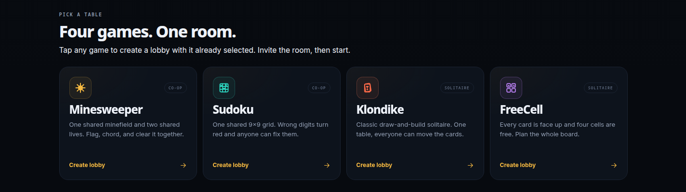
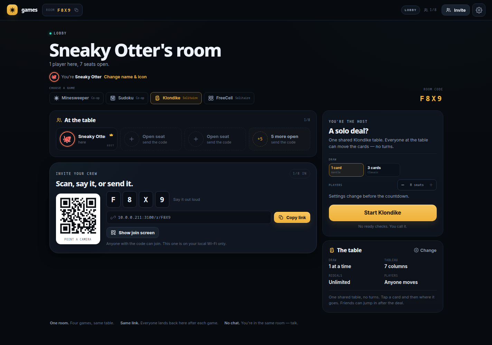
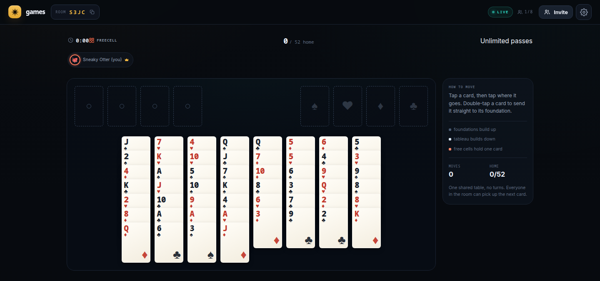
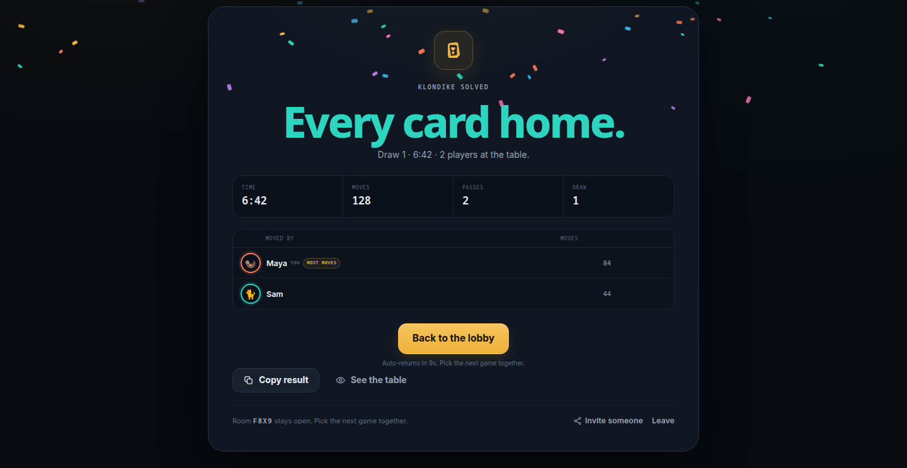

# Games, together

A real-time game table for people sitting in the same room. Create one four-character room, pick **Minesweeper**, **Sudoku**, **Klondike**, or **FreeCell** together in the lobby, and come back to the lobby after every game. Two to eight players, no accounts, and no chat. **New with a friend** starts a two-seat table for a quick 1-on-1. The landing page lists all four games: tap one and it creates a lobby with that game already selected.

The link is the product: create a room, show the QR or say the code, and everyone is sweeping the same board in seconds. The same room and link survive rematches.

## What it looks like



**The lobby is base camp.** Pick the game, see who is seated, and hand out the invite without leaving the screen.



**One table, everybody's hands on it.** FreeCell dealt face up with four free cells and four foundations. There are no turns, so nobody waits for a slow player.



**The result is a group photo.** Time, moves, passes, and who moved most, then everyone drifts back to the lobby for the next game.



## Why it is shaped this way

- **The room is the product.** The code and link stay the same across games. Everyone lands back in the lobby after each result, then the host picks the next game.
- **Co-op Minesweeper.** Everybody reveals and flags the same minefield. Two lives belong to the table. Mistakes are shared, which is the point.
- **Co-op Sudoku.** Everyone fills one shared 9×9 grid. Wrong digits turn red and anyone can replace them. No lives, just time.
- **Solitaire, shared.** Klondike and FreeCell are two separate games on one shared table. There are no turns and no private deals — anyone at the table can pick up the next card.
- **New with a friend.** The home page has a one-tap two-seat table; the start stays locked until the second player is connected.
- **Join first, name later.** Opening a room link takes a seat immediately with a generated name and avatar. The lobby has a visible **Change name & icon** control, so nobody has to fill in a form before getting to the table.
- **No chat.** You are in the same room. The UI stays quiet: cursors, reveal rings, hearts, and a countdown. Voice does the rest.
- **Four-character rooms.** `K7QP` is easy to say across a table and easy to type. The alphabet skips vowels and `0/O/1/I/L` so there are no accidental words or ambiguous characters.
- **One link for the whole session.** Lobby, game, results, and the next game all live at `/r/K7QP`. Copying the address bar always copies a working invite.
- **Node.js on the server.** One process serves the client, the HTTP API, the WebSocket stream, and the OG preview tags. Rooms live in memory.

## Stack

- **Client:** React 19, TypeScript, Vite, plain CSS, `qrcode` for the invite QR.
- **Server:** Node.js 22, Fastify 5, `@fastify/websocket` (ws), Zod for message validation.
- **No database:** rooms are ephemeral. A server restart closes live rooms; start a new one.
- **No accounts:** guests get a random name, an avatar, a color, and a per-room resume token in `localStorage`.

## Run it

```bash
npm install
npm run dev
```

Open <http://localhost:5173>. The Node server runs on `3000`; Vite proxies `/api` and `/ws` to it.

For a production-style run:

```bash
npm run build
npm start
```

Open <http://localhost:3000>.

## Playing in person on a LAN

The host can run the app on a laptop and everyone joins over the same Wi-Fi.

- On boot the server prints its LAN address, for example `http://192.168.1.42:3000`.
- If the host opened the app on `localhost`, the invite panel automatically swaps the link and QR to the machine's LAN address (it asks `/api/config` for it).
- The invite panel shows a **Same Wi-Fi only** note in that mode. The link only works while the server is awake and everyone is on the same network.
- On plain HTTP LAN origins, the browser clipboard API may be unavailable. The invite panel falls back to a selectable field, and the QR/code path still works.
- In development, the QR points at the Vite port (5173) and Vite listens on all interfaces; the API and WebSocket are proxied to `3000`.

For a public deployment, set `PUBLIC_ORIGIN` so link previews and OG tags use the real domain.

## Environment

| Variable | Default | Purpose |
|---|---|---|
| `PORT` | `3000` | HTTP/WebSocket port |
| `HOST` | `0.0.0.0` | Bind address |
| `PUBLIC_ORIGIN` | request origin | Canonical origin for OG URLs, e.g. `https://play.example` |
| `CLIENT_DIR` | `dist/client` | Built client directory |
| `TRUST_PROXY` | unset | Set to `1` when running behind a trusted reverse proxy |

## How a room works

1. `POST /api/rooms` creates a room and returns a four-character code plus a host token.
2. The host opens `/r/CODE`; the client stores the token and claims the host seat over the WebSocket.
3. Everyone else opens the same URL and is seated automatically. They can change their name and avatar from the lobby at any time.
4. The host picks a game in the lobby (or the landing page picks it at creation) and starts. The server runs a three-second countdown, creates the game, and broadcasts it.
5. Minesweeper reveals, flags, chords, lives, and cursors are server-authoritative; the server never sends unrevealed mine locations. Sudoku entries are server-authoritative and the solution is only sent with the final result. Klondike and FreeCell moves are validated by the server and the stock and face-down cards stay hidden.
6. Results appear at the end, then everyone returns to the lobby automatically (or the host can go back immediately) and picks the next game.

Rooms pause when everyone disconnects and close 24 hours after the last activity. Disconnected seats are held for 90 seconds in the lobby and 5 minutes during a round. Host control migrates to the earliest connected player after 60 seconds.

The first click is always safe: mines are placed after that click, excluding the clicked cell and its eight neighbours.

## Rules and controls

**Minesweeper**

- The flag counter counts flags placed **plus mines that were accidentally hit**, so a triggered mine still counts as an accounted-for mine.
- Tap/click a hidden tile to reveal it.
- Long-press on touch, right-click on desktop, or switch to **Flag** mode to place a flag.
- Tap a revealed number whose flags match its count to chord (reveal all remaining neighbours).
- Desktop keyboard: arrows move, Space/Enter reveals or chords, `F` flags.
- Shared lives: every mine costs the table one heart. At zero the round ends and all mines are shown.
- Board presets: Cozy 9×9/10, Classic 16×16/40, Big 30×16/99. Hosts can change the board size and seat count directly in the lobby; the settings sheet handles lives and late join.

**Sudoku**

- One shared 9×9. Darker cells are givens and cannot be changed.
- Tap a cell and a number, or use `1`–`9` on a keyboard. `Backspace`/`Delete` clears a cell.
- Wrong digits turn red. Anyone can replace them, so the table fixes mistakes together.
- The server validates every entry against the solution and checks for a complete grid. No lives; the result records time and mistakes.
- Difficulty choices are Easy (45 clues), Medium (36), and Hard (30).
- Late join is on by default so a friend can jump into a running game.

**Klondike**

- One shared table. Build the four foundations up from ace to king, and build the seven tableau columns down in alternating colours.
- Tap the stock to draw one or three cards (host setting). When the stock is empty, tap it again to recycle the waste.
- Kings are the only cards that start an empty tableau column.
- Tap a card and then tap its destination. Double-tap a card to send it straight to its foundation when the move is legal.

**FreeCell**

- All 52 cards are dealt face up into eight columns; the first four columns have seven cards. No stock.
- Four free cells hold one card each. Foundations build up by suit, tableau columns build down in alternating colours.
- Sequences move as a unit when there are enough free cells and empty columns.
- Same controls as Klondike: tap, then tap the destination, or double-tap to auto-send to a foundation.
- The lobby records moves by player in the result. There are no turns and no private hands.

## Scripts

```bash
npm run dev        # Node + Vite, hot reload
npm run build      # typecheck, build client, bundle server
npm start          # run the production build
npm run typecheck  # tsc --noEmit
npm test           # board, solitaire, sudoku, room, protocol, and code tests
```

## Project layout

```
assets/         README screenshots (cropped viewport captures)
src/
  client/
    components/    board, sudoku, solitaire, lobby, invite panel, results, dialogs
    lib/           socket, storage, router, cursors, copy, API
    pages/         home, join, room
    styles.css
  server/
    index.ts       HTTP, static files, OG meta, WebSocket upgrade
    room.ts        room state machine, game selection, intents, host migration
    registry.ts    room codes, creation limits, TTL sweep
    board.ts       mine placement, flood fill, numbers
    sudoku.ts      Sudoku generator, solver, completion check
    solitaire.ts   Klondike and FreeCell deal, move validation, win check
    protocol.ts    Zod message schemas
  shared/
    types.ts       room/player/round/message types and codes
tests live beside the source as *.test.ts
```

## Deploying

A small Dockerfile is included:

```bash
docker build -t minesweeper-together .
docker run -p 3000:3000 -e PUBLIC_ORIGIN=https://play.example minesweeper-together
```

Use one instance. Rooms are in memory and WebSocket connections must reach the same process. If you need multiple instances or restart survival, move room state to Redis and add sticky room routing.

## Limits and deliberate cuts

- **No accounts, friends list, public matchmaking, or chat.** The link and the table are the social layer.
- **No database.** A process restart ends live rooms.
- **Four-character codes are casual, not secret.** Join attempts are rate-limited. For a public stream, do not show the code on screen.
- **No kick UI.** The host can close the room; a leaked link is handled by closing it.
- **No sound.** Multiple devices in one room would turn it into a casino. There are haptics on flagging and a visual celebration on a win.
- **Classic 16×16 on a phone is dense.** The tiles are still tappable and the long-press flag works; Cozy is the friendlier preset for a phone-only table.
